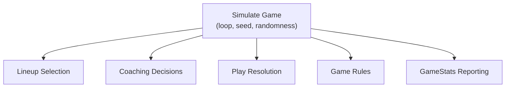

# Simulate Game domain model

Status: merged draft for discussion. This document builds on [the requirements](0004-simulate-game-requirements.md). It supersedes their Flag and Penalty scope: the supported Flags, at most one Flag per Play, and the related enforcement rules are replaced by [section 4.3](#43-flags-and-penalties). How the simulator produces that behavior, and the GameSim engine it is based on, are described in [the Flags and Penalties companion](0006-simulate-game-flags-penalties-companion.md). Terms are defined in [the glossary](GLOSSARY.md). It merges three proposals: the Claude proposal is the base, and ideas from the Codex and Gemini proposals are added where they complement it. Settled questions are in [Resolved decisions](#9-resolved-decisions). This document does not choose code structure.

## 1. The shape of one Game

Simulate Game turns **starting information** and an optional **seed** into a **completed Game**. Inside, a Game repeats one cycle until the Game Rules declare it over:

1. The engine reads the current **Game State**.
2. **Lineup Selection** puts each Team's On-field Players on the field from its Depth Chart and current eligibility.
3. **Coaching Decisions** choose what happens next, such as the next Play, a Team Timeout, or an onside kick.
4. **Play Resolution** uses chance and **Player Attributes** to turn the Play into a raw result: what happened on the field.
5. The **Game Rules** turn the raw result into a Play Outcome. When the Play has Flags, the Game Rules list the Penalty Options, Coaching Decisions makes the Penalty Decision, and the Game Rules enforce it.
6. The Play Outcome and any non-Play events are appended to the **Play-by-Play**, which produces the next Game State.

When the Game is over, **GameStats Reporting** derives the Box Score and Game Result from the Play-by-Play.

Three kinds of knowledge are involved and should stay distinct:

| Kind | Nature | Examples |
| --- | --- | --- |
| Game Rules | Deterministic, fixed, auditable | Downs, scoring, kickoff spots, Penalty enforcement, Overtime ending, clock stoppages |
| Play resolution | Probabilistic, calibrated | Yards gained, completion, Fumble, Injury, Flag occurrence, time consumed |
| Coaching decisions | Strategic, situation-aware | Play choice, fourth down, Timeouts, Penalty Decision, onside kick |

## 2. Recommended modules

Six modules follow from the knowledge split in section 1. Each is framed by what it hides, not by code shape. The interfaces are conceptual, for discussion.

### 2.1 Simulate Game

- **Given:** starting information and an optional seed.
- **Produces:** a completed Game, with its Game Result, Box Score, and Play-by-Play.
- **Hides:** the loop over the other five modules, and ownership of the randomness so that the same input and seed reproduce the same Game (I25).
- It is the outermost and smallest interface.

### 2.2 Game Rules

- **Given:** a Game State and a raw Play result.
- **Produces:** the Penalty Options, then the Play Outcome and the next Game State.
- **Hides:** downs, scoring, Tries, kickoff spots, touchbacks, Overtime termination, Timeout reset, and the clock-stop rules, including the two-minute warning, the end of a period, and untimed downs. It also hides all of Flags and Penalties (section 4.3): during which parts of a Play each Penalty can occur, the limit of two Flags per Play, the Penalty Options, enforcement spots, tack-on enforcement, half-the-distance, the two-Flag rules, and which results an accepted Penalty cancels.
- It is deterministic and pure, and it is the densest concentration of football knowledge. Scenario tables like section 8 become its tests directly.
- It absorbs the Gemini proposal's *ClockManager* (the stop rules), the enforcement half of its *PenaltyEnforcer*, and the Codex proposal's "Game progression": period, clock, Possession, Down, Field Position, and Overtime eligibility depend on one another, so their invariants are kept together.

### 2.3 Play Resolution

- **Given:** a Game Situation, a chosen Play, On-field Players with their Attributes, and randomness.
- **Produces:** a raw result. This covers yards, events such as completions, Fumbles, Recoveries, and blocks, Injuries, up to two Flags, and the time consumed. Each Flag has its position in the Play, its spot when its Penalty is enforced from the Flag's spot, and its offending Player when its Penalty names one.
- **Hides:** the formulas and calibration that relate Player Attributes to outcomes, including attribute match-ups such as passer accuracy against pass coverage and pass blocking against pass rush. It also hides how often each Flag occurs, where a Flag's spot falls, and which Player is charged. Which Penalties may occur, and when, is decided by the Game Rules.
- It is the likeliest place for a real second adapter: a baseline formula and a calibrated one, or a scripted resolver for rules tests.
- A Player filling another Position's slot can be resolved with that Player's per-slot summary rating (`ovrs`) for the slot. This is a candidate input to the formulas, which remain deferred.

### 2.4 Coaching Decisions

- **Given:** a Game Situation and the eligible Players.
- **Produces:** the Play choice, fourth-down choice, Timeout, tempo, onside kick, the choice between an extra point and a two-point attempt, and the Penalty Decision.
- **Hides:** strategy.
- It makes the Penalty Decision for the Team entitled to it, selecting one of the Penalty Options the Game Rules list. It is not consulted when the Game Rules allow only one Penalty Option. Its initial strategy is described in the companion. It can be replaced later by User control or by coaching tendencies.

### 2.5 Lineup Selection

- **Given:** a Depth Chart, Player eligibility, and the needed Formation and side (offense, defense, kicking, or receiving).
- **Produces:** On-field Players.
- **Hides:** Depth Chart Slot traversal, the cross-Position fallback, the KR and PR return slots, injury replacement, the injured-Player fallback when fewer than 11 eligible Players remain (I15), and the rule that a Player never fills two places on the same Play.
- This is the Gemini proposal's *PersonnelManager* and the Codex proposal's "Participation".

### 2.6 GameStats Reporting

- **Given:** the Play-by-Play.
- **Produces:** the Box Score and the Game Result.
- **Hides:** every statistic definition. Examples are gross and net passing, solo and assisted tackles, forced and recovered Fumbles, partial Return yards, and Penalty counts and yards. Which results count is recorded in the Play-by-Play by the Game Rules, so GameStats Reporting never re-applies Penalty rules.
- Because results are *derived* from the Play-by-Play, I23 and I24 hold by construction. This replaces the Gemini proposal's *StatisticsLedger*, which recorded statistics alongside each Play.

### 2.7 Time

- **Time consumed by a Play belongs to Play Resolution.** Play Resolution reports the duration as part of the raw result. The Game Rules never decide how long a Play lasts. They decide only when the Game Clock stops, the two-minute warning, the end of a period, and untimed downs, applying them to that duration.
- **Time between Plays** is split three ways. Coaching Decisions chooses the tempo, such as hurrying up or running down the clock. Play Resolution produces the time that actually passes. Game Rules decide whether the Game Clock was running, for example not after an incomplete pass or an accepted Penalty.
- **Time on a cancelled Play.** An accepted Penalty cancels football results, not time: the time a Play used still comes off the Game Clock.

### 2.8 Outside Simulate Game

Translating the Reference Data into starting information is an adapter outside these six modules. Field names such as `tid`, `pid`, and `depth` belong to that adapter, not to the domain. A seam is not established merely because the present data has a particular JSON format.

## 3. Required Starting Information

The starting information is the input to Simulate Game. It is immutable during the Game.

| Concept | Contents | From the Reference Data |
| --- | --- | --- |
| Game | Identity, home Team, away Team | A schedule entry gives `homeTid`, `awayTid`, and `day`. It has no Game identifier, so the caller supplies the identity. |
| Team | Identity, Roster, Depth Chart | A Team record, by `tid` |
| Roster | The Team's Players | The Players whose `tid` matches the Team. Each Team has 52. |
| Player | Identity, name, primary Position, Player Attributes | `pid`, `firstName` and `lastName`, `pos`, and the 2026 ratings record |
| Depth Chart | An ordering of Players per Depth Chart Slot | The Team's `depth`. Each of the 13 slots ranks all 52 Players by `pid`. |
| Seed | Optional | Not in the data. Supplied by the caller. |

Rules for the starting information:

- Each Team's entire Roster is its **Game Roster**. Every Player on it is eligible at the start, regardless of availability or designation in the source data, such as an `injury` field.
- There are 13 Depth Chart Slots: the 11 Positions (QB, RB, WR, TE, OL, DL, LB, CB, S, K, and P) plus the return slots KR and PR. Because every slot ranks the whole Roster, the cross-Position fallback is concrete: the slot's next eligible Player fills in.
- The initial capability assumes distinct Team identities, each Player on only one of the two Rosters, and Depth Charts that refer only to Players on their own Team. Handling malformed or incomplete starting information is deferred.
- The starting information need not use the Reference Data's JSON structure.
- The following are **not** part of the starting information: historical, financial, and presentation data (contracts, awards, images, college, draft history), historical `stats` (these are Player Statistics, not Player Attributes), weather, stadium effects, and coaching tendencies.

The Reference Data holds 32 Teams, 1,664 Players, and 272 scheduled matchups across 18 `day` values.

## 4. Concepts and relationships

### 4.1 Game State (changes during the Game)

Game State is everything needed to continue the Game:

- **Game Situation**: Score, Possession, Down, Yards to Go, Field Position, Quarter or Overtime, Game Clock, and Remaining Team Timeouts. This is what Coaching Decisions and Play Resolution consult.
- **Pending action**: what must happen next. This is a snap from scrimmage, a Kickoff (normal, or the kick after a Safety), or a Try after a Touchdown. A Touchdown is followed by a Try, then a Kickoff. A Safety is followed by the kick after a Safety from the conceding Team's 20-yard line. "Down and distance" means nothing while a Kickoff or Try is pending, so the Game Situation must not imply that a normal Down and Yards to Go exist in every phase.
- **Half structure**: which Team receives the second-half kickoff and the two-minute warnings already given.
- **Overtime progress**: whether each Team has had its possession opportunity, and whether the next Score ends the Game.
- **Player eligibility**: the Game Roster minus Players injured so far. The Game Roster stays fixed; only eligibility changes.
- **Play-by-Play so far**.

Field Position is measured relative to the possessing Team's goal line (0 to 100). An absolute coordinate, measured from one fixed goal line, is a possible internal representation that converts to the relative form for decisions and presentation.

### 4.2 Play and Play Outcome

- A **Play** records its kind, its participating Teams (offense or kicking Team, defense or receiving Team), its relevant Players, and the **Game Situation before the Play**.
- A Play's **raw result** is what happened on the field before the rules judge it, as an ordered sequence of events. It includes yards, completion, Fumble, Recovery, Return, block, Injuries, time consumed, and up to two Flags, each at its position in the sequence.
- The **Play Outcome** is the raw result after the Game Rules apply, including the Penalty Decision and enforcement. It explains every change in Score, Possession, Down, Field Position, and Game Clock, and states for each event of the raw result whether it counts.
- **Non-Play events** are Flags before the snap (the intended Play never happens), Injuries, Team Timeouts, Quarter changes, the two-minute warning, and the end of the Game.

### 4.3 Flags and Penalties

**Principle: simplicity over realism.** Where realism would add a new mechanism, the simpler behavior is preferred. Where the real football rule is no more complex, it is used. An explanation of how the simulator produces this behavior, is available in [the companion](0006-simulate-game-flags-penalties-companion.md).

**Concepts**

- **Flag type**: one of the 32 named kinds of rule violation, such as Holding or False start.
- **Flag**: one occurrence of a Flag type on a Play. It has an offending Team, an offending Player when its Penalty names one, and its position in the Play's raw result.
- **Penalty**: the prescribed consequence of a Flag type for one offending side. Holding is one Flag type with an offensive and a defensive Penalty. There are 43 Penalties.
- **Offending side**: offense or defense, relative to the Team in Possession when the Flag occurs. On a Kickoff or Punt Return, the returning Team is the offense, so a Kicking-Team face mask during a Return is a defensive Penalty. Kicking Team and Receiving Team describe the Play, not the side of a Penalty.
- **Penalty Option**: one combination of accepting and declining the Penalties of a Play's Flags that the Game Rules permit. When the rules force a result, there is a single Penalty Option.
- **Penalty Decision**: Coaching Decisions selecting one Penalty Option for the Team entitled to it. Every Flag, including a Flag before the snap, offers the offended Team a Penalty Decision unless the rules force the result.
- **Accepted**: football results after the Flag are cancelled (see *What an accepted Penalty cancels*). The Penalty counts against the offending Team, and against the offending Player when one is named.
- **Declined**: the Play Outcome stands, including a change of Possession or Score. No Penalty yards are charged.
- **Offsetting Penalties**: opposing Penalties on the same Play that cancel each other. The Down is replayed and no Penalty yards are charged.

The Flags and the Penalty Decision stay in the Play-by-Play in every case.

**Penalty descriptions.** Each Penalty is described by a small set of facts:

- the Flag type and the offending side;
- the parts of a Play during which it can occur: before the snap, Pass Play, Run Play, Punt, Punt Return, Kickoff Return, or Field Goal Attempt;
- yards;
- enforcement spot: where the Play began, the Flag's spot, or the end of the run or Return (**tack-on enforcement**);
- whether it gives an automatic first down. Otherwise the Down is replayed, subject to the shared first-down rules;
- whether it names an offending Player.

The 32 Flag types are a closed set for now. A new Flag type is added as new Penalty descriptions. The set of facts grows only when a Penalty cannot be described with the existing ones.

**The Penalties**

Enforcement-spot values used in the table:

- **Play start**: where the Play began. For a Flag before the snap, where the Play would have begun.
- **Flag's spot**: the spot of the Flag. Defensive pass interference in the end zone places the ball at the 1-yard line.
- **Tack-on**: the end of the run or Return, keeping the yards gained, when the Play gains yards and the pass is not incomplete. Otherwise Play start. During a Kickoff or Punt Return, a defensive Penalty is always enforced from the end of the Return.
- **Play start, Flag's spot on a Return**: an offensive Penalty during a Kickoff or Punt Return is enforced from the Flag's spot. Otherwise Play start.

| # | Flag type | Side | Can occur during | Yards | Enforcement spot | Automatic first down |
| --- | --- | --- | --- | ---: | --- | --- |
| 1 | Holding | Offense | Kickoff Return, Field Goal, Punt, Punt Return, Pass, Run | 10 | Play start, Flag's spot on a Return | No |
| 2 | False start | Offense | Before the snap | 5 | Play start | No |
| 3 | Pass interference | Defense | Pass | To the Flag's spot | Flag's spot | Yes |
| 4 | Holding | Defense | Pass, Run | 5 | Play start | Yes |
| 5 | Unnecessary roughness | Defense | Kickoff Return, Field Goal, Punt, Punt Return, Pass, Run | 15 | Tack-on | Yes |
| 6 | Unnecessary roughness | Offense | Kickoff Return, Field Goal, Punt, Punt Return, Pass, Run | 15 | Play start, Flag's spot on a Return | No |
| 7 | Illegal block in the back | Offense | Punt Return, Kickoff Return | 10 | Flag's spot | No |
| 8 | Neutral zone infraction | Defense | Before the snap | 5 | Play start | No |
| 9 | Offsides | Defense | Field Goal, Punt, Pass, Run | 5 | Play start | No |
| 10 | Roughing the passer | Defense | Pass | 15 | Tack-on | Yes |
| 11 | Delay of game | Offense | Before the snap | 5 | Play start | No |
| 12 | Delay of game | Defense | Before the snap | 5 | Play start | No |
| 13 | Face mask | Defense | Pass, Run, Kickoff Return, Punt Return | 15 | Tack-on | Yes |
| 14 | Face mask | Offense | Pass, Run, Kickoff Return, Punt Return | 15 | Play start, Flag's spot on a Return | No |
| 15 | Pass interference | Offense | Pass | 10 | Play start | No |
| 16 | Illegal formation | Offense | Pass, Run | 5 | Play start | No |
| 17 | Illegal use of hands | Defense | Pass, Run | 5 | Play start | Yes |
| 18 | Illegal use of hands | Offense | Pass, Run | 10 | Play start | No |
| 19 | Unsportsmanlike conduct | Defense | Before the snap | 15 | Play start | Yes |
| 20 | Unsportsmanlike conduct | Offense | Before the snap | 15 | Play start | No |
| 21 | Illegal shift | Offense | Before the snap | 5 | Play start | No |
| 22 | Illegal contact | Defense | Pass | 5 | Play start | Yes |
| 23 | Too many men on the field | Defense | Pass, Run, Field Goal | 5 | Play start | No |
| 24 | Too many men on the field | Offense | Pass, Run, Field Goal | 5 | Play start | No |
| 25 | Encroachment | Defense | Before the snap | 5 | Play start | No |
| 26 | Taunting | Offense | Kickoff Return, Field Goal, Punt Return, Pass, Run | 15 | Play start, Flag's spot on a Return | No |
| 27 | Taunting | Defense | Kickoff Return, Field Goal, Punt Return, Pass, Run | 15 | Tack-on | Yes |
| 28 | Lowering the head to initiate contact | Defense | Kickoff Return, Punt Return, Pass, Run | 15 | Tack-on | Yes |
| 29 | Ineligible receiver downfield | Offense | Pass | 5 | Play start | No |
| 30 | Horse collar tackle | Defense | Kickoff Return, Punt Return, Pass, Run | 15 | Tack-on | Yes |
| 31 | Chop block | Offense | Run | 15 | Play start | No |
| 32 | Illegal motion | Offense | Before the snap | 5 | Play start | No |
| 33 | Tripping | Offense | Kickoff Return, Punt Return, Pass, Run | 10 | Play start, Flag's spot on a Return | No |
| 34 | Tripping | Defense | Kickoff Return, Punt Return, Pass, Run | 10 | Tack-on | Yes |
| 35 | Illegal substitution | Offense | Before the snap | 5 | Play start | No |
| 36 | Illegal substitution | Defense | Before the snap | 5 | Play start | No |
| 37 | Ineligible man downfield | Offense | Punt | 5 | Play start | No |
| 38 | Illegal blindside block | Offense | Run, Pass | 15 | Play start | No |
| 39 | Leverage | Defense | Field Goal | 15 | Play start | Yes |
| 40 | Illegal touching | Offense | Pass | 5 | Play start | No |
| 41 | Clipping | Offense | Pass, Run | 15 | Play start | No |
| 42 | Illegal crackback block | Offense | Pass, Run | 15 | Play start | No |
| 43 | Illegal low block | Offense | Pass, Run | 15 | Play start | No |

Every Penalty names an offending Player except Delay of game, Too many men on the field, and Illegal substitution, which are charged to the Team alone. Offensive Holding never names the ball carrier.

**When Flags can occur**

- A Play has at most two Flags.
- Offsides is called only against the defense. The offense's equivalent is False start.
- Unsportsmanlike conduct occurs only before the snap. No Flag occurs after a Play ends, and no Penalty carries over to the next Kickoff or Try.
- No Flag occurs on a Try, an Onside Kick, or a Kickoff that ends in a touchback. A Punt that ends in a touchback has no Punt Return Flags.
- A Blocked Kick has only the Flags that occur before the kick.
- No Flag occurs during an Interception Return or a Fumble Return. A Flag earlier in the Play can still cancel the Interception or Fumble.
- Whether a Flag occurs does not depend on what happened earlier in the Play or on any Player Attribute. What happened decides only which parts of the Play took place, such as whether there was a Return.

**What an accepted Penalty cancels**

- Results before the Flag count, and results after it are cancelled. On a scrimmage Play, the whole Play is cancelled. On a Kickoff or Punt Return, the kick and the change of Possession stand, and the Return is cancelled.
- With tack-on enforcement, the gain up to the end of the run or Return is kept.
- When a Penalty is enforced from the Flag's spot during a Return, the returner keeps the Return yards gained up to that spot.
- A Flag before the snap means the intended Play does not happen and uses no time.
- Injuries and the time a Play used are never cancelled.

**Rules shared by every Penalty**

- Half the distance: enforcement never moves the ball more than half the distance to the offending Team's goal line. This applies to both sides. The only exception is Pass Interference by the Defense.
- Results are whole yards, rounded away from the offending Team's goal line, so enforcement never reaches a goal line (D7, D7a).
- Enforcement never scores.
- A first down is earned when the Penalty yards reach the line to gain, when the Penalty gives an automatic first down, or when the part of the Play that counts includes a change of Possession.
- An accepted Penalty or Offsetting Penalties stop the Game Clock. A declined Penalty leaves the clock as the Play left it.
- Untimed down: an accepted defensive Penalty on a Play that ends with the clock expired at the end of a half or of Overtime gives one untimed down. Offsetting Penalties at 0:00 end the half. At the end of Q1 or Q3, the situation carries over instead (D4).
- Penalty yards in the Box Score are the yards actually enforced, not the Penalty's nominal yards.

**Two Flags on one Play**

- **Against the same Team:** the Penalty Options are to decline both, accept only the first, or accept only the second. Both are never accepted.
- **Against opposing Teams**, applied in this order:
  1. **Major over minor.** When one Team's Penalty is 5 yards and the other's is 15 yards or defensive pass interference, the major Penalty is accepted and the 5-yard Penalty declined. Offensive pass interference is not major.
  2. **No change of Possession:** Offsetting Penalties. The Down is replayed from where the Play began.
  3. **Change of Possession, clean hands:** the Team that gained Possession keeps the ball if it did not foul before gaining Possession. The opponent's Penalty is declined, and the keeping Team's own Penalty is enforced against it. If the Team that gained Possession fouled before gaining it, the Penalties offset and the Down is replayed.
  
  These results are forced, so each case has a single Penalty Option.

**Where enforcement lives.** All Penalty enforcement is inside Game Rules. Which Penalties can occur during each part of a Play, and the two-Flag limit, are Game Rules facts. How often Flags occur, where a Flag's spot falls, and which Player is charged belong to Play Resolution.

### 4.4 Results (output)

- **Play-by-Play**: the chronological, append-only record. It is the source of truth. Each Play's entry holds both its raw result and which of its results count, so results cancelled by a Penalty stay visible but never count.
- **Box Score**: team and Player Statistics, with the Game Result included. Players are identified by identity, not name.
- **Game Result**: the final Score and the outcome (home win, away win, or tie).
- **Injuries**: each injured Player and when the Injury happened. This can be read from the Play-by-Play.

Recommended stance: treat the Game Result and Box Score as derived from the Play-by-Play, never built alongside it. The requirement that all three "describe the same Game" then holds by construction instead of needing a separate check.

Beyond the required minimum, candidate Box Score measures include:

- **Team**: first downs, total, passing, and rushing yards, Penalties and Penalty yards, turnovers, and time of possession.
- **Player**: sack yards, longest run and reception, tackles for loss, assisted tackles, punts inside the 20, and punt touchbacks.

The exact statistics remain to be defined.

## 5. Player Attributes and Categorization

### 5.1 The ratings record

- All 1,664 Players have exactly one ratings record (season 2026). Its `pos` matches the 11 Positions.
- Ratings are integers from 0 to 100, except `fuzz`, which ranges from −3 to 3. The whole scale is used, so a typical value is about 50.
- Height is the 0–100 `hgt` rating. The top-level Player `hgt` (inches) and `weight` are not Player Attributes.
- Mean ratings by Position follow the expected pattern. For example, `thv`, `thp`, and `tha` are high only for QBs. `kpw`, `kac`, `ppw`, and `pac` are high only for Ks and Ps. `pcv` is high for CBs and Ss, `rbk` and `pbk` for OL, and `prs` and `rns` for DL.
- A high overall rating does not guarantee performance. The particular mix of ratings matters, as do a Player's teammates.

### 5.2 Base ratings by category

The 21 base ratings map onto exactly the seven Attribute categories named in the requirements.

| Category | Key | Meaning | Typical influence | Most relevant Positions |
| --- | --- | --- | --- | --- |
| Physical | `hgt` | Height | Jump balls, reach | WR, TE, CB, S |
| Physical | `stre` | Strength | Push, run blocking, shedding blocks | OL, DL |
| Physical | `spd` | Speed | Separation, pursuit, breakaway gains | RB, WR, CB, S |
| Physical | `endu` | Endurance | Stamina (no effect yet; D8) | All |
| Passing | `thv` | Throwing vision | Reading the defense, avoiding Interceptions | QB |
| Passing | `thp` | Throwing power | Pass distance, deep passes | QB |
| Passing | `tha` | Throwing accuracy | Completion probability | QB |
| Ball-carrying | `bsc` | Ball security | Resisting Fumbles | RB, WR, TE, QB |
| Ball-carrying | `elu` | Elusiveness | Breaking tackles, yards after contact | RB, WR |
| Receiving | `rtr` | Route running | Separation from coverage | WR, TE, RB |
| Receiving | `hnd` | Hands | Catching reliability | WR, TE, RB |
| Blocking | `rbk` | Run blocking | Run Play success | OL, TE |
| Blocking | `pbk` | Pass blocking | Pass protection | OL, TE, RB |
| Defensive | `pcv` | Pass coverage | Pass defense | CB, S, LB |
| Defensive | `tck` | Tackling | Bringing down the ball carrier | LB, S, DL |
| Defensive | `prs` | Pass rushing | Pressure and sacks | DL, LB |
| Defensive | `rns` | Run stopping | Shedding blocks, stopping runs | DL, LB |
| Kicking | `kpw` | Kicking power | Kickoff and Field Goal distance | K |
| Kicking | `kac` | Kicking accuracy | Field Goal and extra-point accuracy | K |
| Kicking | `ppw` | Punting power | Punt distance and hang time | P |
| Kicking | `pac` | Punting accuracy | Punt placement | P |

The "typical influence" column describes intent. The formulas that relate Attributes to outcomes are deferred, and not every Attribute must affect every Play.

### 5.3 Summary ratings, skills, and fuzz

| Key | Meaning |
| --- | --- |
| `ovr` | Overall rating at the Player's primary Position |
| `pot` | Potential rating at the primary Position |
| `ovrs` | Overall rating for each of the 13 Depth Chart Slots, including KR and PR |
| `pots` | Potential rating for each of the 13 Depth Chart Slots |
| `skills` | Skill labels derived from the base ratings |
| `fuzz` | Scouting noise applied to displayed ratings |

### 5.4 Decided (D8)

- All ratings are Player Attributes: the 21 base ratings and `ovr`, `pot`, `ovrs`, `pots`, `skills`, and `fuzz`. The set may be reviewed later.
- `skills` summarize the base ratings and `fuzz` is scouting noise. Both are carried, but Play Resolution is not expected to use them as independent causes.
- `endu` is carried as an Attribute even though nothing in the Game uses it yet, because the requirements have no fatigue.

## 6. Invariants

**Situation**

- I1. Field Position always lies between the goal lines (0 to 100 from the possessing Team's goal line). A ball that ends beyond a goal line has already become a Touchdown, Safety, or touchback.
- I2. Field Position and Yards to Go are whole yards.
- I3. A Down and Yards to Go exist only when a snap from scrimmage is pending. Then the Down is between 1 and 4, and Yards to Go is at least 1 and never more than the distance to the goal line ("& goal").
- I4. A new set of downs starts at 1st down with Yards to Go equal to the smaller of 10 and the distance to the goal line.
- I5. A Fumble alone never changes Possession. Possession changes only through a Recovery or Interception, a kick, a turnover on Downs, or the Kickoff after a Score.
- I6. The Game Clock is between 0 and the period length (15:00, or 10:00 in Overtime), and it never increases within a period.
- I7. Remaining Team Timeouts is between 0 and the allowance: 3 per half, or 2 in Overtime. Timeouts reset at each half and before Overtime.
- I8. The two-minute warning is given at most once per half.
- I9. The Score never decreases. Each change equals 6, 3, 2, 1, or 2 points from a scoring Play Outcome, and never from Penalty enforcement.

**Sequencing**

- I10. Every Touchdown is followed by a Try. The only exception is a Game already ended by an Overtime rule. A Try happens even when the clock reached 0 during the scoring Play.
- I11. Every successful Field Goal and every Try is followed by a Kickoff by the scoring Team. A Safety is followed by a kick from the conceding Team's 20-yard line. The exception in both cases is the end of a half or of the Game.
- I12. Possession and Down carry over from Q1 to Q2 and from Q3 to Q4. Q3 opens with a Kickoff to the Team that did not receive the opening kickoff.
- I13. A Play that starts with time remaining finishes and counts. An accepted defensive Penalty on a Play that expires a half or Overtime gives one untimed down. Offsetting Penalties do not. At the end of Q1 or Q3, the situation carries over instead.
- I14. Overtime is played only when regulation ends tied. The Game ends exactly when an Overtime ending condition (D5) is met, and only after Penalty enforcement on the Play is settled.

**Players**

- I15. Each Play's On-field Players are 11 distinct Players per Team, drawn from that Team's Game Roster. They are eligible Players, except that when fewer than 11 eligible Players remain, injured Players fill the shortfall in Depth Chart order.
- I16. The Game Roster never changes during the Game. Eligibility only decreases: an injured Player appears in no later Play unless the shortfall rule in I15 applies. Earlier Plays and statistics are unaffected.
- I17. Every Player referenced in a Play belongs to one of the two Game Rosters, is referenced by identity, and participates only for their own Team.

**Flags**

- I18. A Play has at most two Flags. Each is one of the 32 Flag types, with a Penalty that can occur during that part of the Play.
- I19. Enforcement, by either side, never moves the ball more than half the distance to the offending Team's goal line. It never scores. Defensive pass interference in the end zone places the ball at the 1-yard line.
- I20. Rounded half-the-distance results are whole yards and move away from the offending Team's goal line, so enforcement never reaches a goal line.
- I21. An accepted Penalty never cancels an Injury or the time the Play used.
- I22. A declined Penalty changes nothing in the Play Outcome and charges no Penalty yards. An accepted Penalty is charged to the offending Team, and to the offending Player when one is named, with the yards actually enforced.
- I26. At most one Penalty is accepted against each Team on a Play.
- I27. Offsetting Penalties charge no Penalty yards to either Team.
- I28. A Try, an Onside Kick, a Kickoff that ends in a touchback, and an Interception or Fumble Return never have a Flag.

**Results**

- I23. The final Score equals the sum of counting scoring Play Outcomes: 6 × Touchdowns + 3 × Field Goals + 2 × Safeties + 1 × extra points + 2 × two-point conversions. The Game Result agrees with the final Score.
- I24. Player Statistics come only from Plays that count. Team totals equal the sum of Player totals where the measures are comparable. For example:
  - receptions = completions;
  - receiving yards = gross passing yards;
  - net passing yards = gross passing yards − sack yards;
  - team rushing yards = the sum of Player rushing yards.
- I25. Determinism: the same starting information, seed, and simulator version produce an identical completed Game, including Play-by-Play, statistics, and Injuries.

## 7. How invariants map to modules

| Module | Invariants it owns |
| --- | --- |
| Game Rules | I1–I14, I18–I22, I26–I28 |
| Lineup Selection | I15–I17 |
| GameStats Reporting | I23, I24 |
| Simulate Game | I25 |

Play Resolution and Coaching Decisions own no invariants. Their outputs are validated by the Game Rules.

## 8. Scenarios used to test the model

| # | Scenario | Expected by the model | Status |
| --- | --- | --- | --- |
| S1 | 3rd & 8 at own 40. Defensive holding, 5-yard enforcement. | Accepted gives 1st & 10 at own 45 (automatic first down). | Clear |
| S2 | 1st & 10 at opponent 6. Offensive holding. | The ball goes back 10 yards to the 16, 1st & goal from the 16. Half-the-distance does not apply, because the offense's own goal line is far away. | Clear |
| S3 | 2nd & 5 at own 3. Offensive holding. | Half the distance gives the 1.5-yard line, rounded away from the goal line to the 2: 2nd & 6. No Safety. | Resolved (D7, D7a) |
| S4 | Interception returned for a Touchdown. Offside on the defense. | The offense would accept, cancel the Interception, replay the Down, and move 5 yards. Declining keeps the defense's Touchdown. The decision belongs to the offense. | Clear |
| S5 | Punt return. Illegal block in the back by the receiving Team at its own 30. | The kick and change of Possession stand. The receiving Team starts 1st & 10 at its own 20. The returner keeps the Return yards up to the 30. | Clear |
| S6 | Punt return. Face mask by the **kicking** Team. The sample Game shows this. | A defensive Penalty during the Return (D2): tack-on enforcement from the end of the Return. The Return yards count, and the receiving Team gets a first down. | Resolved (D2) |
| S8 | A Q2 Play starting at 0:02 ends at 0:00 with an accepted defensive Penalty. | Untimed down. | Resolved (D4) |
| S9 | Overtime. The first Team kicks off, recovers a fumbled return, and scores. | Ends Overtime immediately, because the receiving Team gained Possession before the fumble, so both Teams have had their chance. | Resolved (D5) |
| S10 | Overtime. The first possession ends in a Field Goal. The second Team scores a Touchdown with time left. | The second Team takes the lead and the Game ends at once, with no Try. | Resolved |
| S11 | Overtime. The first possession ends with a Touchdown at 0:03. The Try is good. Time expires during the Kickoff. | The Game ends with the first Team ahead. "If time remains" applies. | Clear |
| S12 | The starting QB and backup are injured. | The QB slot falls through to the Depth Chart's next eligible Player, such as a WR. | Clear |
| S13 | A Player is injured on a Play cancelled by an accepted Penalty. | The Injury counts. The Player is ineligible from the next Play, and plays again only under the shortfall rule (I15). | Clear |
| S14 | A two-point attempt is intercepted. | It ends without points and there is no return. | Clear |
| S15 | Offside by the offense. | Does not occur. The offense's equivalent is False start. | Resolved (D6) |
| S16 | A 4th-down conversion fails at the opponent's 35. | Turnover on Downs. The opponent gets 1st & 10 at its own 35. | Clear |
| S17 | A missed 52-yard Field Goal from the opponent's 35. | The kick spot is the 42 (7 yards back). The defending Team takes Possession at its own 42, which is farther from its goal line than the 20. | Clear |
| S18 | 2nd & 5 at the opponent's 15. Defensive pass interference in the end zone. | Accepted gives 1st & goal at the 1. The incomplete pass is cancelled and no passing or receiving statistics are credited. | Clear |
| S19 | 1st & 10 at own 30. The RB runs 35 yards. An offensive lineman holds, and the RB is injured on the Play. | The defense accepts. The run is cancelled and the RB gets no rushing yards. 1st & 20 at own 20. The Injury stands, and Lineup Selection puts the next eligible RB in the slot for the next Play. | Clear |
| S20 | Overtime. Team A scores a Touchdown and kicks the extra point (27–20). Team B scores a Touchdown with 1:20 left (27–26) and attempts a two-point conversion. | Good: Team B leads 28–27 and the Game ends. Failed: Team B's possession has ended while behind, and Team A wins 27–26. | Clear |
| S21 | 4th & 12 at own 10. The punt is blocked and the defense recovers in the end zone. | Touchdown for the defense. The block and the Players involved are recorded. No Flag can occur after the block (D3). A Try follows. | Clear |
| S22 | Kickoff from the 35 to the goal line, returned 40 yards to the receiving Team's 40. Illegal block in the back at its own 25. | The kick and Possession stand. The Return from the Flag onward is cancelled, and the returner keeps the Return yards up to the 25. Ball at the receiving Team's 15, 1st & 10. | Clear |
| S23 | A run ends in a Fumble that the ball carrier's own Team recovers. | No change of Possession. The Fumble is counted but not as a fumble lost. | Clear |
| S24 | A 20-yard completion for a first down. Defensive offside. | The offense declines. The Play Outcome stands. The Flag and the decision are in the Play-by-Play, and no Penalty yards are charged. | Clear |
| S25 | Overtime. The first possession ends in a Safety. | Overtime ends immediately and the defense wins, because a Safety ends Overtime (D5). | Clear |
| S26 | 2nd & 5 at own 1. Offensive holding. | Half the distance is 0.5, rounded away from the goal line to the 1. 2nd & 5 at own 1. 0 Penalty yards are charged. | Resolved (D7a, D11) |
| S27 | 2nd & goal at the opponent's 3. Defensive holding. | Half the distance applies to the defense: 1.5, rounded to the 2. 1st & goal at the 2. 1 Penalty yard is charged. | Resolved (D11) |
| S28 | 2nd & 10 at own 40. Offensive holding and illegal formation on a run. | Penalty Options: decline both (the run stands), accept Holding (2nd & 20 at own 30), or accept illegal formation (2nd & 15 at own 35). Both are never accepted. | Resolved (D13) |
| S29 | 1st & 10 at own 40. False start. | The Play does not happen and uses no time. Penalty Options: accept (1st & 15 at own 35) or decline (1st & 10 at own 40). | Resolved (D10, D15) |
| S30 | 4th & 4 at the opponent's 20. Defensive offsides; the Field Goal is good. | Accept: the Field Goal and its 3 points are cancelled, and the 5 yards reach the line to gain: 1st & 10 at the opponent's 15. Decline: the 3 points stand and a Kickoff follows. | Clear |
| S31 | A Try, either an extra point or a two-point attempt. | No Flag can occur. The Try's result alone decides the points. | Resolved (D14) |
| S32 | 1st & 10 at own 40. Offensive illegal formation (5 yards) and defensive pass interference with the Flag's spot at the opponent's 45. | Major over minor: defensive pass interference is accepted and illegal formation declined, with no Penalty Decision. 1st & 10 at the opponent's 45. | Resolved (D13) |
| S33 | 1st & 10 at own 40. Defensive offsides (5 yards) and offensive pass interference (10 yards), with no change of Possession. | Offensive pass interference is not major, so the Penalties offset. 1st & 10 at own 40, no Penalty yards, and the Game Clock stops. | Resolved (D13) |
| S34 | Q2, 1st & 10 at own 40 at 0:02. Offsetting holding Penalties on a Play that ends at 0:00. | No untimed down. The half ends. | Resolved (D4) |
| S35 | 4th & 10 at own 40. Kicking-Team holding during the Punt. The receiving Team catches at its own 20 and returns to its 40, with illegal block in the back at its own 30. | Clean hands: the receiving Team did not foul before gaining Possession, so it keeps the ball. The holding is declined. The illegal block is enforced from the 30: 1st & 10 at its own 20, and the returner keeps 10 Return yards. | Resolved (D13) |
| S36 | 4th & 10 at own 40. Defensive offsides during the Punt. The receiving Team catches and returns, with Kicking-Team tripping (10 yards) during the Return. | The receiving Team fouled before gaining Possession, and major over minor does not apply. The Penalties offset: 4th & 10 at own 40 is replayed. | Resolved (D13) |
| S37 | 1st & 10 at own 40. A run to midfield with a defensive face mask during the run. | Tack-on enforcement from the end of the run: the 10-yard gain counts, plus 15 yards. 1st & 10 at the opponent's 35. | Resolved (D12) |

## 9. Resolved decisions

- **D1. Depth Chart Slots.** A Depth Chart ranks Players per Depth Chart Slot: the 11 Positions plus KR and PR. Any slot may rank the whole Roster, so an eligible Player from another Position can fill in. The 52-player Rosters are a property of this input, not a rule.
- **D2. Sides on kicks and Returns.** A Penalty's side is set by Possession when the Flag occurs. The kick itself is between the Kicking Team and the Receiving Team. Once the Receiving Team has Possession, it is the offense for the Return. A Kicking-Team Penalty during a Return is therefore defensive and uses tack-on enforcement from the end of the Return.
- **D3. Returns without Flags.** No Flag occurs during an Interception Return or a Fumble Return, or after a kick is blocked. A Flag earlier in the Play can still cancel the Interception, Fumble, or block.
- **D4. Untimed down.** An accepted defensive Penalty on a Play that ends with the clock expired at the end of a half or of Overtime gives an untimed down. Offsetting Penalties at 0:00 end the half. At the end of Q1 or Q3, the resulting situation carries into the next Quarter instead.
- **D5. Overtime.** Both Teams always have the opportunity to possess. A Team's opportunity begins the moment it gains Possession, even if it loses the ball on the same Play. Once both Teams have gained Possession, the next Score that leaves one Team ahead ends the Game. A Safety on the first possession ends the Game. Penalty enforcement on a Play is settled before any Overtime ending is checked, so a cancelled Score never ends the Game. These rules are fixed and belong to Game Rules.
- **D6. Offsides.** Offsides is called only against the defense. The offense's equivalent is False start.
- **D7. Whole yards.** Field Position is always whole yards. Half-the-distance results are rounded.
- **D7a. Rounding direction.** Half-the-distance results are rounded *away from* the offending Team's goal line, so the ball at the 1.5 goes to the 2. Enforcement therefore never reaches a goal line (I20).
- **D8. Attribute set.** Every rating in the ratings record is a Player Attribute: the 21 base ratings and `ovr`, `pot`, `ovrs`, `pots`, `skills`, and `fuzz`. The set may be reviewed later. Height is the 0–100 `hgt` rating.
- **D9. Flag scope.** The model specifies 32 Flag types, 43 Penalties, and up to two Flags per Play (section 4.3). The Flag types are a closed set for now, but new ones can be added. The governing principle is simplicity over realism.
- **D10. Penalty Decision.** Every Flag, including a Flag before the snap, offers Penalty Options. Coaching Decisions selects one, unless the rules force the result.
- **D11. Half the distance for both sides.** Half the distance applies to offensive and defensive Penalties alike.
- **D12. Tack-on enforcement.** A defensive Penalty marked tack-on, on a Play that gains yards, is enforced from the end of the run or Return. A defensive Penalty during a Kickoff or Punt Return is always enforced from the end of the Return. There is no choice of enforcing from where the Play began.
- **D13. Two Flags.** When both Flags are against the same Team, at most one Penalty is accepted. Opposing Flags are resolved by major over minor, then Offsetting Penalties without a change of Possession, then clean hands with a change of Possession. Defensive pass interference counts as major, and offensive pass interference does not.
- **D14. Plays without Flags.** No Flag occurs on a Try, an Onside Kick, or a Kickoff that ends in a touchback. A Punt touchback has no Punt Return Flags. Unsportsmanlike conduct occurs only before the snap.
- **D15. Flags before the snap.** The intended Play does not happen and uses no time.
- **D16. Time and the Game Clock.** An accepted Penalty never cancels the time the Play used. An accepted Penalty or Offsetting Penalties stop the Game Clock.
- **D17. Penalty statistics.** Penalty yards are the yards actually enforced. When a Penalty is enforced from the Flag's spot during a Return, the returner keeps the Return yards up to that spot.
- **D18. Flag occurrence.** Whether a Flag occurs depends neither on earlier events in the Play nor on Player Attributes. How often Flags occur is left to calibration.
- **D19. Offending Player.** Delay of game, Too many men on the field, and Illegal substitution are charged to the Team alone. Every other Penalty names an offending Player. Offensive Holding never names the ball carrier.
- **D20. Injured-Player shortfall.** When fewer than 11 eligible Players remain, injured Players fill the shortfall in Depth Chart order (I15).
- **D21. Play-by-Play and Penalties.** Each Play's entry records its raw result and which of its results count. GameStats Reporting derives everything from it and never re-applies Penalty rules.
- **D22. Enforcement placement.** All Penalty enforcement is inside Game Rules. There is no separate Penalty module.
- **D23. Game Clock precision.** The Game Clock is kept in whole seconds: 0–900 per Quarter, or 0–600 in Overtime. Time used by a Play is whole seconds too. This avoids drift and makes the two-minute warning and the end of a period exact. The sample Game's fractional minutes are a representation choice, not a rule.
- **S10.** In Overtime, after a first-possession Field Goal, a second-Team Touchdown ends the Game immediately, with no Try.

## 10. Open for discussion

Deferred by the requirements, and not decided here:

- numerical plausibility targets and calibration, including how often each Flag occurs and which Positions are most often charged;
- the formulas relating Player Attributes to outcomes, including whether Injury chance depends on any Attribute;
- malformed-input handling;
- the effect of Injuries on later Games, including Injury duration. This model assumes neither that an Injury carries over nor that it is cleared.
