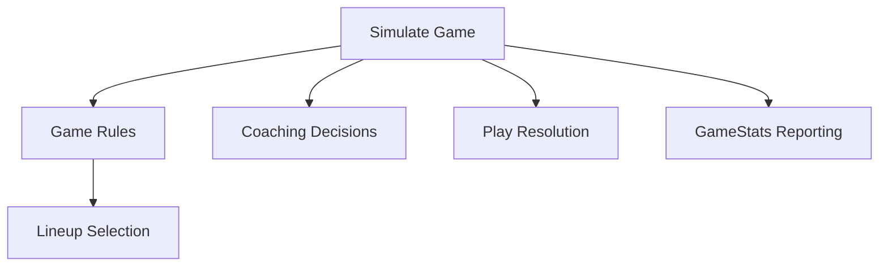

# Simulate Game interface design

Status: draft for discussion. This document defines the module interfaces of Simulate Game. It conforms to [the domain model](0006-simulate-game-domain-model.md) and [the Flags and Penalties companion](0006-simulate-game-flags-penalties-companion.md): no Game Rule, invariant, resolved decision, scenario, or companion mechanism changes. Where the domain model's section 2 sketches conceptual interfaces, this document makes them concrete (section 8). Terms come from [the glossary](GLOSSARY.md).

Design terms follow Ousterhout's *A Philosophy of Software Design*. A module is **deep** when a lot of behavior sits behind a small interface. A module's **interface** is everything a caller must know to use it, including its invariants, ordering constraints, and error modes.

The sketches use TypeScript notation because it expresses tagged unions and readonly data compactly. This is not a choice of language ([0001](0001-ai-agents-use.md) leaves the stack open).

The document reads in this order: the objects (section 1), one Play followed through the modules (section 2), each module (section 3), and how the modules take turns (section 4).

## 1. The objects

### 1.1 Before the Game: Teams and Players

The starting information is built outside Simulate Game, by the adapter that reads the Reference Data (domain 2.8). It never changes during the Game.

```ts
interface StartingInformation {
  readonly game: { readonly id: GameId; readonly home: Team; readonly away: Team }
}

interface Team {
  readonly id: TeamId
  readonly name: string
  readonly roster: readonly Player[]                                     // the Game Roster
  readonly depthChart: Readonly<Record<DepthChartSlot, readonly PlayerId[]>>
}

interface Player {
  readonly id: PlayerId
  readonly name: string
  readonly position: Position
  readonly attributes: PlayerAttributes                                  // domain section 5
}
```

The adapter checks what domain section 3 assumes: distinct Teams, Rosters that share no Player, Depth Charts that name only their own Team's Players, and at least 11 Players per Roster. Because the check happens there, Simulate Game itself has no error mode.

### 1.2 During the Game: Game State and Game Situation

**Game State** is everything Game Rules keeps track of: both Teams, the Game Situation, Player eligibility, the half and Overtime progress, and the Play-by-Play so far. Only Game Rules reads it. Other modules see the parts they need.

**Game Situation** is the part everyone sees. Coaching Decisions and Play Resolution consult it.

```ts
type HomeOrAway = 'home' | 'away'
type Seconds = number                   // whole seconds (D23)
type Yards = number                     // whole yards

interface GameSituation {
  readonly score: { readonly home: number; readonly away: number }
  readonly period: 1 | 2 | 3 | 4 | 'overtime'
  readonly clock: Seconds               // left in the period: 0–900, or 0–600 in Overtime
  readonly timeouts: { readonly home: 0 | 1 | 2 | 3; readonly away: 0 | 1 | 2 | 3 }
  readonly possession: HomeOrAway
  readonly next:
    | { readonly kind: 'snap'; readonly down: 1 | 2 | 3 | 4; readonly yardsToGo: Yards; readonly fieldPosition: Yards }
    | { readonly kind: 'kickoff'; readonly from: Yards; readonly afterSafety: boolean }
    | { readonly kind: 'try'; readonly fieldPosition: Yards }
}
```

`next` is the pending action (domain 4.1). Down and Yards to Go exist only when a snap is next, so invariant I3 holds by the type itself.

### 1.3 A Play

A Play has a **call**, the **On-field Players**, **what happened on the field**, and a **Play Outcome**.

```ts
interface PlayCall {
  readonly play: 'run' | 'pass' | 'punt' | 'fieldGoal' | 'kneel' | 'spike'
  readonly tempo: 'normal' | 'hurry' | 'slow'
}

interface OnFieldPlayers {
  readonly team: HomeOrAway
  readonly players: readonly { readonly player: Player; readonly slot: DepthChartSlot }[]   // exactly 11
}
```

Each On-field Player comes with the Depth Chart Slot they fill, so Play Resolution can use that Player's rating for the slot (`ovrs`, domain 2.3).

**What happened on the field** is a list of events and the time used. Events never contain a ruling such as Touchdown, Safety, touchback, first down, or Penalty yards. Those are decided by Game Rules. A pass caught at the opponent's 2-yard line is an event; whether it scored is a ruling.

```ts
interface WhatHappened {
  readonly events: readonly FieldEvent[]
  readonly time: { readonly beforeSnap: Seconds; readonly live: Seconds }
}

type FieldEvent =
  | { kind: 'snap' }
  | { kind: 'handoff'; to: PlayerId }
  | { kind: 'dropback'; passer: PlayerId }
  | { kind: 'pass'; passer: PlayerId; target: PlayerId; targetAt: Yards
      result: 'complete' | 'incomplete' | 'intercepted'; defendedBy?: PlayerId; interceptedBy?: PlayerId }
  | { kind: 'sack'; passer: PlayerId; by: readonly PlayerId[]; at: Yards }
  | { kind: 'kick'; kicker: PlayerId; type: 'kickoff' | 'onside' | 'punt' | 'fieldGoal' | 'extraPoint'
      from: Yards; to?: Yards; through?: boolean }                 // through: between the uprights
  | { kind: 'blocked'; by: PlayerId }
  | { kind: 'touch'; player: PlayerId; at: Yards }                // a kicked ball touched, as on an Onside Kick
  | { kind: 'fumble'; by: PlayerId; forcedBy?: PlayerId; at: Yards }
  | { kind: 'recovery'; by: PlayerId; at: Yards }                 // of a fumble, a blocked kick, or an Onside Kick
  | { kind: 'advance'; carrier: PlayerId; from: Yards; to: Yards }
  | { kind: 'ballDead'; at: Yards; how: 'tackle' | 'outOfBounds' | 'downed' | 'kneel' | 'spike' | 'endZone' | 'incomplete'
      tacklers?: readonly PlayerId[] }                             // everyone in on the tackle
  | { kind: 'injury'; player: PlayerId }
  | { kind: 'flag'; penalty: PenaltyId; player?: PlayerId; spot?: Yards }
```

Yards in events are measured from the goal line of the Team that had Possession at the snap or kick. One frame per Play means a change of Possession during the Play does not flip the coordinates. An advance that a Flag interrupts is recorded as two advances split at the Flag's spot.

The events say who has the ball: the target of a completed pass, the interceptor, the recovering Player, or the Player who advances a kick. Game Rules works out from those Players' Teams whether Possession changed. An Injury is recorded among the events of the Play on which it happened, which also records when it happened.

The **Play Outcome** is what the Play means once Game Rules has judged it:

```ts
interface PlayOutcome {
  readonly after: GameSituation
  readonly scored?: {
    readonly team: HomeOrAway
    readonly points: 1 | 2 | 3 | 6
    readonly how: 'touchdown' | 'fieldGoal' | 'safety' | 'extraPoint' | 'twoPoint'
    readonly player?: PlayerId          // the Player credited with the score, when there is one
  }
  readonly possessionChange?: 'interception' | 'recovery' | 'kick' | 'downs'
  readonly touchback: boolean
  readonly firstDown: boolean
  readonly clock: 'running' | 'stopped'
  readonly untimedDown: boolean
  readonly endsGame: boolean
}
```

The Play Outcome holds every ruling that statistics and the Play-by-Play need: who scored and how, a touchback, how Possession changed (including a turnover on Downs), and a first down. GameStats Reporting reads them and never works them out from the events.

**Coverage.** These events and the Play Outcome express every line of the sample Game and every Box Score statistic the requirements list. That includes passing, rushing, receiving, tackles, sacks, Interceptions, forced and recovered fumbles, kicking, punting, and Returns. It also includes two-point attempts, return and defensive Touchdowns, Safeties, fumbles lost, blocked punts and Field Goal Attempts, and Onside Kick attempts and recoveries.

A **Penalty Option** (domain 4.3) is one way to accept or decline a Play's Penalties, together with the Play Outcome it gives:

```ts
interface PenaltyOption {
  readonly accepted: readonly PenaltyId[]     // empty when every Penalty is declined
  readonly outcome: PlayOutcome
}
```

### 1.4 After the Game: the completed Game

```ts
interface CompletedGame {
  readonly seed: Seed                   // the seed supplied, or the one generated
  readonly engineVersion: string
  readonly playByPlay: PlayByPlay
  readonly boxScore: BoxScore           // includes the Game Result
}
```

The **Play-by-Play** records each Play with the Game Situation before it, its call, its On-field Players, what happened, whether each event counts, its Penalties, and its Play Outcome (D21, companion 1.7). It also records the non-Play events.

```ts
interface PlayByPlay {
  readonly game: { readonly id: GameId; readonly home: TeamId; readonly away: TeamId }
  readonly entries: readonly Entry[]
}

type Entry =
  | { kind: 'play'; before: GameSituation; call: PlayRequest['call']
      onField: { home: readonly PlayerId[]; away: readonly PlayerId[] }
      events: readonly { event: FieldEvent; counts: boolean }[]
      time: WhatHappened['time']; penalties?: PenaltyRecord; outcome: PlayOutcome }
  | { kind: 'flagBeforeSnap'; before: GameSituation; flag: FieldEvent; penalties: PenaltyRecord; outcome: PlayOutcome }
  | { kind: 'timeout'; team: HomeOrAway; at: Seconds }
  | { kind: 'twoMinuteWarning' | 'periodEnd' | 'gameEnd'; at: Seconds }

interface PenaltyRecord {
  readonly options: readonly PenaltyOption[]
  readonly decision: { readonly by: HomeOrAway; readonly chosen: number } | 'forced'
  readonly enforced: readonly { readonly penalty: PenaltyId; readonly against: HomeOrAway; readonly player?: PlayerId; readonly yards: Yards }[]
}
```

Each event's `counts` is a plain yes or no, because an interrupted advance is split at the Flag's spot. In S22 the Return becomes an advance from the goal line to the 25 that counts, then an advance from the 25 to the 40 that does not.

## 2. One Play, step by step

Home has 3rd & 8 at its own 40 with 9:12 left in Q2.

| # | Module | What happens | Objects passed |
| --- | --- | --- | --- |
| 1 | Game Rules | Offers the away coach a Timeout, because the defense has Timeouts left. | Game Situation, a Decision |
| 1 | Coaching Decisions | Declines. | `'none'` |
| 1 | Game Rules | Asks the home coach for the call. The menu lists only legal choices: run, pass, punt, field goal, kneel, spike, each with a tempo, and a Timeout. | Game Situation, a Decision |
| 1 | Coaching Decisions | Chooses a pass at normal tempo. | PlayCall |
| 2 | Game Rules | Asks Lineup Selection for 11 home Players (offense) and 11 away Players (defense). Lists the Penalties that can be called before the snap and on a pass. | Team, eligible Players, OnFieldPlayers |
| 3 | Play Resolution | Reports what happened: the snap, a pass to the WR that falls incomplete, and defensive holding by the CB. The Play used 6 seconds. | PlayRequest in, WhatHappened out |
| 4 | Game Rules | Enforces both choices in advance and asks the home coach: accept gives 1st & 10 at own 45, decline gives 4th & 8 at own 40. | Two Penalty Options |
| 4 | Coaching Decisions | Chooses to accept. | PenaltyOption |
| 5 | Game Rules | Records the Play in the Play-by-Play. The new Game Situation is 1st & 10 at own 45, 9:06 left, clock stopped. | Entry, Game Situation |

Simulate Game repeats this until the Game ends. GameStats Reporting then turns the Play-by-Play into the Box Score.

## 3. The modules

| Module | Job | Interface |
| --- | --- | --- |
| Simulate Game | Plays a whole Game | `simulateGame(start, seed?)` |
| Game Rules | Knows the rules and the order of a Game | `GameRules.start(start, coinFlips)`, `GameRules.step(state)` |
| Coaching Decisions | Chooses from a menu of legal choices | `decide(decision, situation, rng)` |
| Play Resolution | Says what happened on the field | `resolvePlay(request, rng)` |
| Lineup Selection | Puts 11 Players on the field | `selectLineup(team, eligible, unit)` |
| GameStats Reporting | Builds the Box Score | `reportBoxScore(playByPlay)` |



### 3.1 Simulate Game

```ts
function simulateGame(start: StartingInformation, seed?: Seed): CompletedGame
```

- **Hides:** the seed and its random streams, the coin flips, the wiring of the other modules, and the assembly of the completed Game.
- **Flips the coins up front.** Before the Game, Simulate Game flips one coin for the opening kickoff and one for the Overtime kickoff, and passes both to Game Rules. The Overtime flip goes unused when regulation does not end tied. The choice is pure chance, so no module decides it.
- **Guarantees I25.** The returned seed always reproduces the Game, even when the caller supplied none.
- **Separate random streams.** Play Resolution and Coaching Decisions draw from separate streams derived from the seed. A change in how often Coaching Decisions draws then does not alter every later Play, which keeps calibration comparisons between versions local.
- **No other parameters.** The rules are fixed, and calibration is data inside Play Resolution.
- **Precondition:** the starting information passed the adapter's checks (section 1.1).
- **Performance:** a Game is a few hundred steps of pure computation. The 272 Games of a Season are not a performance concern.

### 3.2 Game Rules

```ts
namespace GameRules {
  function start(start: StartingInformation, coinFlips: CoinFlips): GameState
  function step(state: GameState): Step        // section 4
}

interface CoinFlips {                          // the Team that receives each kickoff
  readonly opening: HomeOrAway
  readonly overtime: HomeOrAway
}
```

- **Hides:** everything in domain 2.2. That covers downs, scoring, Tries, Kickoffs, touchbacks, the Game Clock and its stoppages, the two-minute warning, untimed downs, Overtime, and Timeout allowances. It also covers all of Flags and Penalties: which Penalties can occur during each part of a Play, the two-Flag limit, Penalty Options, enforcement by rollback, tack-on enforcement, half the distance, and the two-Flag rules. Finally, it hides the order of a Game and the contents of Game State.
- **Owns:** I1–I14, I18–I22, and I26–I28.
- **Asks with menus.** Each decision lists only legal choices, and Game Rules asks only when at least two exist. A fourth-down choice is a Play call that offers punt and field goal. Before every snap, Game Rules first offers the defense a Timeout, then asks the offense for its call, which also offers a Timeout. A Team with no Timeouts left is not offered one. Whether a Timeout is worth calling is for Coaching Decisions to judge.
- **Penalty Options come with their outcomes.** Game Rules enforces each option in advance. Coaching Decisions compares the outcomes (companion 1.6) without knowing any enforcement rule.
- **Puts Players on the field.** Game Rules calls Lineup Selection with the Team, its eligible Players, and the Unit.
- **Checks Play Resolution.** Game Rules checks each WhatHappened against Play Resolution's contract (section 3.4). A violation is a programming error and is thrown. It is never a football outcome, and callers do not handle it.

### 3.3 Coaching Decisions

```ts
function decide<A>(decision: DecisionOf<string, A>, situation: GameSituation, rng: Rng): Option<A>
```

- **Hides:** strategy, including the Penalty Decision factors in companion 1.6 and the seeded tie-break.
- **Guarantees:** it returns one of `decision.options`.
- **Inputs.** The domain model's conceptual inputs are the Game Situation and the eligible Players. No current decision uses the eligible Players, so the interface takes them only when a decision needs them.
- **Future strategies.** Coaching tendencies would be another strategy behind the same function. User control would show the same menu to a person (section 4).

### 3.4 Play Resolution

```ts
function resolvePlay(request: PlayRequest, rng: Rng): WhatHappened

interface PlayRequest {
  readonly situation: GameSituation
  readonly call: PlayCall | 'kickoff' | 'onsideKick' | 'extraPoint' | 'twoPoint'
  readonly offense: OnFieldPlayers      // the Team in Possession at the snap, or the Kicking Team
  readonly defense: OnFieldPlayers      // the other Team, or the Receiving Team
  readonly flagChecks: FlagChecks
}

type PartOfPlay = 'beforeSnap' | 'pass' | 'run' | 'punt' | 'puntReturn' | 'kickoffReturn' | 'fieldGoal'
type FlagChecks = { readonly [P in PartOfPlay]?: readonly PenaltyDescription[] }

interface PenaltyDescription {          // what drawing a Flag needs, and no more
  readonly id: PenaltyId                // for example 'holding/offense'
  readonly flagType: FlagType
  readonly side: 'offense' | 'defense'  // relative to Possession when the Flag occurs (D2)
  readonly offender: 'team' | 'player' | 'playerNotBallCarrier'
  readonly flagSpot: boolean            // whether a Flag of this Penalty has a spot (companion 1.3)
}
```

- **Hides:** the formulas and calibration that relate Player Attributes to outcomes, Flag rates, the offending Player's position weights, the shuffle when too many Flags are drawn, and time consumption.
- **Which Flags can be called arrives in the request.** Game Rules decides which parts of the Play have a Flag check and which Penalties each check can draw (companion 1.1). A Try or an Onside Kick gets no checks, so I28 stays in Game Rules. Play Resolution runs a check only at a part of the Play that both happens and appears in `flagChecks`. A Kickoff that ends in a touchback has no Return, and an Interception Return is not a `PartOfPlay`, so neither needs a special case.
- **Sides on a Return.** A Penalty's side is relative to the Team in Possession when the Flag occurs. On a Punt Return or Kickoff Return check, an offensive Penalty is therefore charged to the Receiving Team, which is `defense` in the request.
- **Enforcement stays in Game Rules.** Play Resolution draws the Flag, its spot when `flagSpot` is set, and the offending Player. Yards, automatic first down, and how the spot is used belong to Game Rules.
- **Contract,** checked by Game Rules:
  - events describe what happened on the field, never rulings;
  - at most two Flags, each drawn at a listed check from that check's Penalties;
  - every Player referenced is in `offense` or `defense`;
  - an advance that a Flag interrupts is split at the Flag's spot;
  - a Flag before the snap is the only event, and `live` is 0.
- **Testing:** property tests over many seeds check the contract, plus statistical calibration tests.

### 3.5 Lineup Selection

```ts
function selectLineup(team: Team, eligible: ReadonlySet<PlayerId>, unit: Unit): OnFieldPlayers

type Unit = 'offense' | 'defense' | 'kickoff' | 'kickoffReturn' | 'onsideKick' | 'onsideReturn'
          | 'punt' | 'puntReturn' | 'fieldGoal' | 'fieldGoalDefense'
```

- **Hides:** the Formation for each Unit, Depth Chart Slot traversal, the cross-Position fallback, the KR and PR slots, injury replacement, the injured-Player shortfall (I15, D20), and the rule that a Player fills only one place.
- **The needed Formation follows from the Unit.** No module chooses a Formation today, so each Unit's Formation is resolved inside Lineup Selection. When Coaching Decisions begins choosing Formations, `Unit` gains an optional Formation.
- **Called by Game Rules,** which already holds the Teams and eligibility.
- **Owns:** I15–I17. It always returns 11 distinct Players, given a Game Roster of at least 11.

### 3.6 GameStats Reporting

```ts
function reportBoxScore(playByPlay: PlayByPlay): BoxScore     // BoxScore.result is the Game Result
```

- **Hides:** every statistic definition.
- **Reads** each event's `counts` and the enforced Penalty yards recorded by Game Rules. It never re-applies Penalty rules (D21).
- **Owns:** I23 and I24, which hold by construction because everything comes from one Play-by-Play.
- **Needs nothing else:** the Play-by-Play names the Game and its Teams.

## 4. How the modules take turns

Every row of the walkthrough in section 2 is one **Step**: Game Rules says what it needs next, and Simulate Game hands that to the module that can answer.

```ts
type Step =
  | { readonly kind: 'decide'; readonly situation: GameSituation; readonly decision: Decision }
  | { readonly kind: 'play';   readonly request: PlayRequest; record(happened: WhatHappened): GameState }
  | { readonly kind: 'over';   readonly playByPlay: PlayByPlay }

type Decision =
  | DecisionOf<'timeout',  'timeout' | 'none'>       // the defense, before every snap, when it has a Timeout left
  | DecisionOf<'playCall', PlayCall | 'timeout'>     // the offense, before every snap
  | DecisionOf<'kickoff',  'normal' | 'onside'>
  | DecisionOf<'try',      'extraPoint' | 'twoPoint'>
  | DecisionOf<'penalty',  PenaltyOption>

interface DecisionOf<Kind extends string, Answer> {
  readonly kind: Kind
  readonly by: HomeOrAway                            // the Team that decides
  readonly options: readonly [Option<Answer>, Option<Answer>, ...Option<Answer>[]]   // at least two
}

interface Option<Answer> {
  readonly value: Answer
  choose(): GameState                                        // "go with this one"
}
```

`choose()` and `record()` give back the next Game State. Game State never changes in place.

Simulate Game is a short loop:

```ts
function simulateGame(start, seed = freshSeed()) {
  const rng = streams(seed)                       // rng.play, rng.coaching, rng.coins
  let state = GameRules.start(start, { opening: rng.coins.flip(), overtime: rng.coins.flip() })
  for (;;) {
    const step = GameRules.step(state)
    switch (step.kind) {
      case 'decide': state = CoachingDecisions.decide(step.decision, step.situation, rng.coaching).choose(); break
      case 'play':   state = step.record(PlayResolution.resolvePlay(step.request, rng.play)); break
      case 'over':   return { seed, engineVersion, playByPlay: step.playByPlay,
                              boxScore: GameStatsReporting.reportBoxScore(step.playByPlay) }
    }
  }
}
```

- **Ordering.** Callers need not know any. A Step can be answered only through its own `choose()` or `record()`, so an answer cannot reach the wrong question. Choosing an option from an older Step forks the Game instead of corrupting it. `step` on a finished Game keeps returning `'over'`.
- **User control later.** A second loop over the same `step` can show each Decision's menu to a person. Game Rules does not change.

**Testing Game Rules.** Tests answer Steps directly, so they need no fake coach and no scripted Play Resolution. To start in the middle of a Game, Game Rules has one test-support function:

```ts
function at(start: StartingInformation, scenario: Scenario): GameState
// Scenario: a Game Situation, plus optional injured Players, the second-half receiver, and Overtime progress
```

`at` checks the scenario against the invariants and throws on an impossible one, so a test cannot start from a state no Game could reach.

The scenarios in domain section 8 become tests through it. Test helpers decline Timeouts unless a test says otherwise:

```ts
test('S28: two offensive Flags give the defense three Penalty Options', () => {
  const state = GameRules.at(game, snapAt({ offense: 'home', down: 2, toGo: 10, ownYardLine: 40 }))
  const play = expectPlay(callPlay(state, call('run')))      // declines the defense's Timeout, then calls the run
  const decision = expectDecision(GameRules.step(play.record(
    happened(play.request).run('RB', 40, 46).flag('holding/offense', 'OL').flag('illegalFormation/offense'))))
  expect(decision.by).toBe('away')
  expect(outcomes(decision)).toEqual([
    { accepted: [],                           after: '3rd & 4 at own 46' },
    { accepted: ['holding/offense'],          after: '2nd & 20 at own 30' },
    { accepted: ['illegalFormation/offense'], after: '2nd & 15 at own 35' },
  ])
})
```

## 5. Errors defined away

| Possible error | How the design removes it |
| --- | --- |
| Choosing an illegal option, such as a Timeout with none left or an extra point when no Try is pending | Decisions are menus of legal choices, answered through each option's `choose()` |
| Choosing a Penalty Option the rules did not list | Same mechanism |
| Asking Coaching Decisions about a forced result | Game Rules asks only when at least two options exist |
| Answering one question with another question's answer | Each Step carries its own `choose()` or `record()` |
| Calling `step` after the Game is over | `step` keeps returning `'over'` |
| Reading Down and distance while a Kickoff or Try is pending | `GameSituation.next` has no Down outside a snap (I3) |
| An unreproducible Game | A seed is always returned |
| A Flag on a Try or an Onside Kick | Game Rules sends no Flag checks |
| Play Resolution misapplying an enforcement rule | It applies none: it sees only what drawing a Flag needs |
| Fractional clock drift and a missed two-minute warning | The Game Clock is whole seconds |
| Malformed starting information inside the Game | Checked by the Reference Data adapter |

Contract violations by Play Resolution remain possible and are thrown as bugs (section 3.4). Property tests over many seeds look for them.

## 6. Seams and adapters

| Module | Seam | Adapters today | When it becomes a real seam |
| --- | --- | --- | --- |
| Simulate Game | External interface | 1 | — |
| Game Rules | Module interface, tested directly | 1 | Not expected: the rules are fixed |
| Play Resolution | Plain function | 1 | When a second, calibrated formula must run beside the baseline |
| Coaching Decisions | Plain function | 1 | User control or coaching tendencies |
| Lineup Selection | Internal to Game Rules' implementation, with its own tests | 1 | When Formations or rotations are chosen elsewhere |
| GameStats Reporting | Plain function | 1 | — |
| Reference Data adapter | Outside Simulate Game | 1 | A second source of starting information |

No module has a port. Game Rules accepts what happened and the choices as plain values, so its tests need no scripted stand-ins. Ports should be added only when a second production adapter exists.

## 7. Ousterhout red-flag review

| Red flag | Where it could appear | How the design avoids it |
| --- | --- | --- |
| Pass-through method | Simulate Game | It owns the seed and its streams, the wiring, and the completed Game. Deleting it would push those into every caller: a Season, tests, a future UI. |
| Pass-through variable | Depth Chart and eligibility reaching Lineup Selection | Game Rules calls Lineup Selection directly |
| Temporal decomposition | Modules named after phases: pre-snap, snap, post-play | Modules split by knowledge. The order of a Game lives inside `GameRules.step`. |
| Classitis | Public `ClockManager`, `PenaltyEnforcer`, `DownTracker` | Those are internal seams of Game Rules |
| Configuration parameter | `maxFlagsPerPlay`, Overtime variants, Flag rates on `simulateGame` | The rules are fixed. Calibration is data inside Play Resolution. `simulateGame` takes only a seed. |
| Information leakage | Enforcement facts in Play Resolution; rulings in field events | `PenaltyDescription` carries only what drawing a Flag needs; events describe only what happened on the field |
| Shallow module | One Coaching method per kind of decision | One `decide` over a menu |

**Change amplification check.** Likely changes and the modules each one touches:

| Change | Modules touched |
| --- | --- |
| Add a Flag type | Game Rules (the Penalty description), Play Resolution (calibration data) |
| Change the Overtime rules | Game Rules |
| Add a Box Score statistic | GameStats Reporting |
| Recalibrate yards or Flag rates | Play Resolution |
| User calls the Plays | A new loop; Game Rules unchanged |
| Add a fair catch decision | Game Rules, Coaching Decisions, Play Resolution (a new event) |
| Choose Formations | Coaching Decisions, Lineup Selection (`Unit` gains a Formation) |

## 8. Relationship to the domain model

This design changes no football behavior. Every Game Rule, invariant, resolved decision, and scenario in the domain model holds as written, and the companion's mechanisms are kept. The domain model's section 2 describes conceptual interfaces "for discussion" and does not choose code structure. This document makes those interfaces concrete, refining them in these places:

| Domain model | This design | Why |
| --- | --- | --- |
| Diagram: Simulate Game calls all five modules | Game Rules calls Lineup Selection | The Depth Chart and eligibility do not pass through Simulate Game |
| 2.2: Game Rules produces the Penalty Options, then the Play Outcome | Each Penalty Option arrives with the Play Outcome it gives | Coaching Decisions compares outcomes (companion 1.6) without enforcement knowledge |
| 2.4: Coaching Decisions is given the eligible Players | Omitted until a decision uses them | No current decision needs them |
| 2.4: not consulted when only one Penalty Option exists | Not consulted when only one option exists, for any decision | One rule instead of a special case |
| 2.5: Lineup Selection is given the needed Formation | The Formation follows from the Unit | No module chooses a Formation yet |